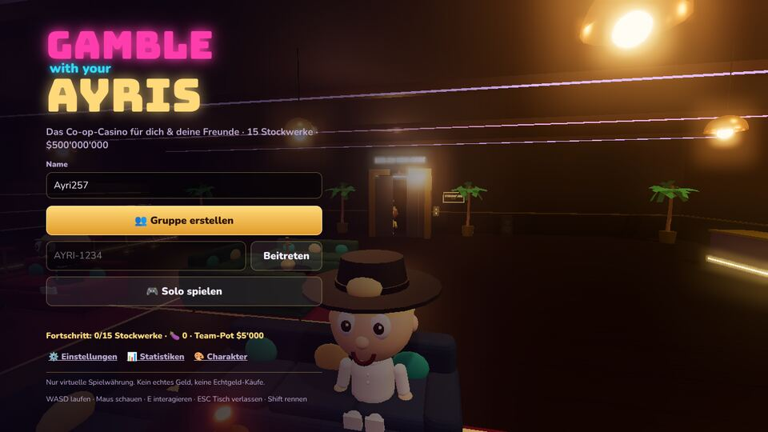
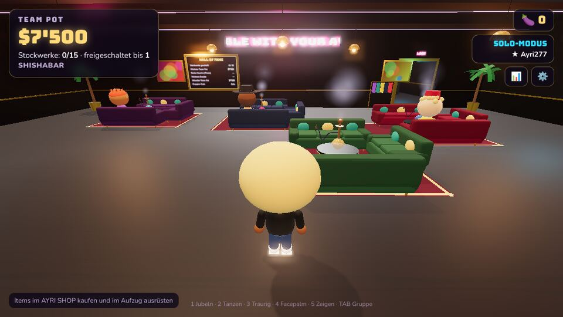
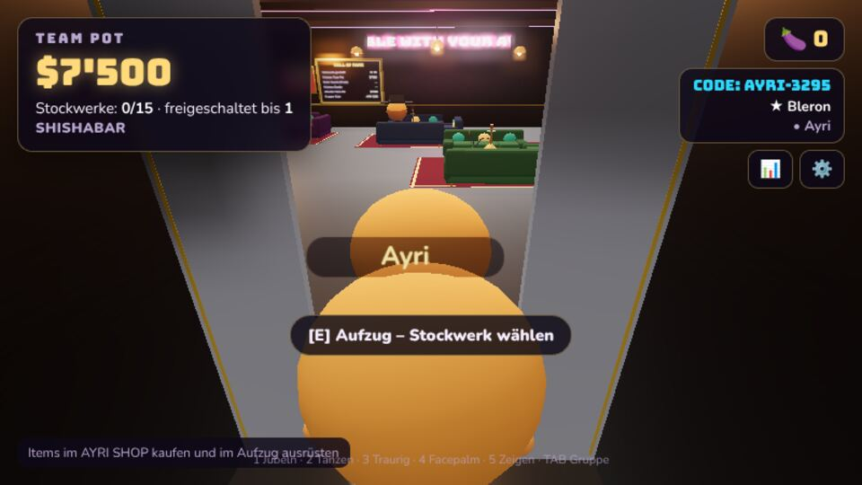
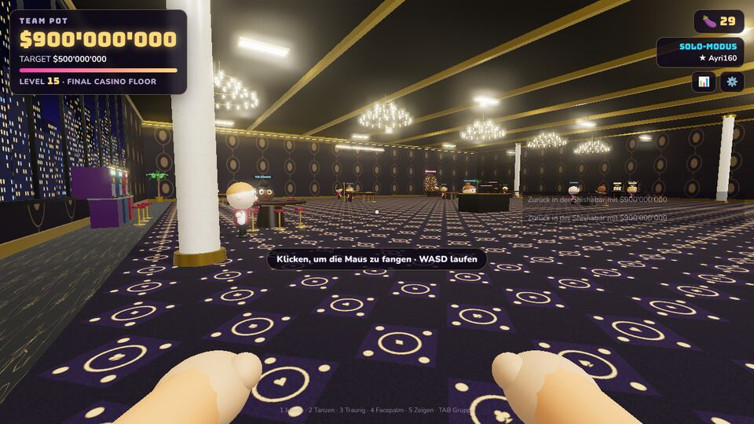
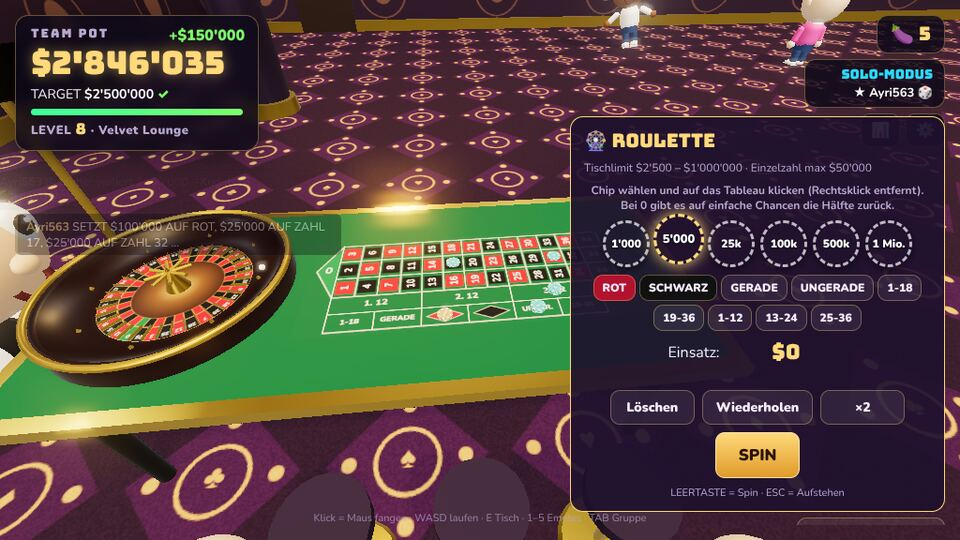
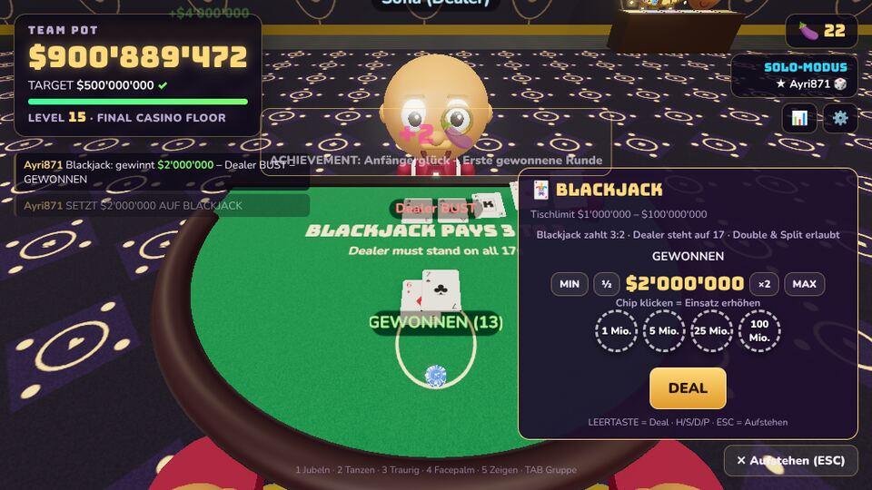
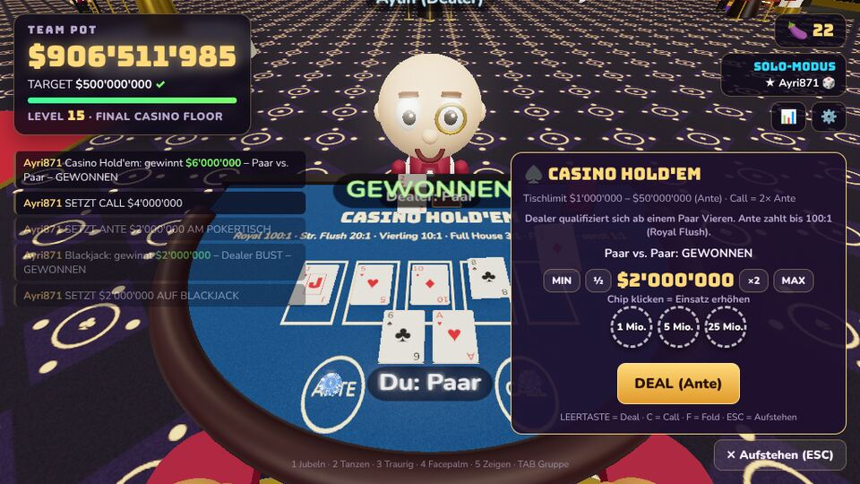
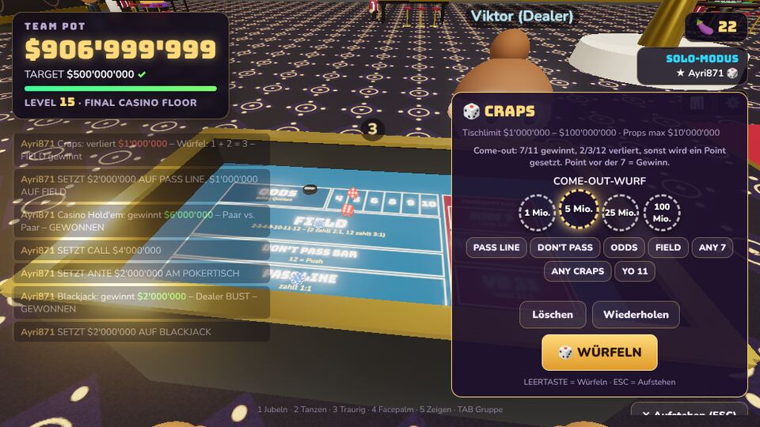
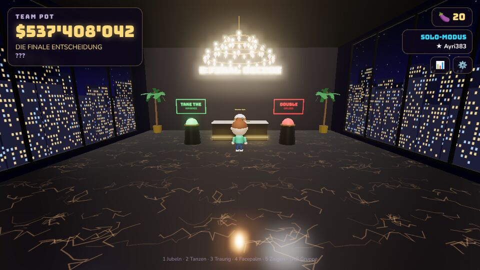
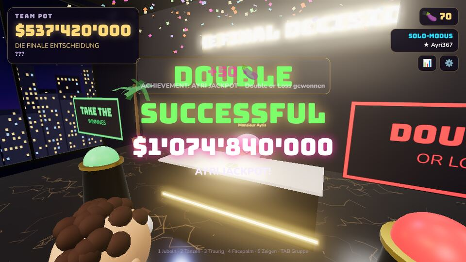

# 🎰 Gamble with your Ayris

Ein humorvolles **3D-First-Person-Co-op-Casino-Spiel** für Freunde – direkt im Browser.
Ihr trefft euch mit euren Cartoon-Charakteren in einer Shishabar, fahrt mit dem Aufzug auf eines von
**15 Casino-Stockwerken**, verzockt gemeinsam einen **Team-Pot** und kämpft euch bis zu
**$500'000'000** hoch – und dann kommt die letzte Frage: **TAKE THE WINNINGS** oder **DOUBLE OR LOSS**?

> ⚠️ Es wird ausschliesslich **virtuelle Spielwährung** verwendet. Kein echtes Geld, keine Echtgeld-Käufe.

| | |
|---|---|
|  |  |
|  |  |
|  |  |
|  |  |
|  |  |

## Schnellstart

```bash
npm install
npm run build
npm start
```

Dann **http://localhost:8787** öffnen.

- **Gruppe erstellen** → es erscheint ein Join-Code wie `AYRI-4827`.
- Freunde öffnen dieselbe Adresse (z. B. `http://<deine-IP>:8787` im selben Netzwerk oder dein
  gehosteter Server) und geben den Code bei **Beitreten** ein.
- **Solo spielen** funktioniert auch ohne Server (der komplette Spielraum läuft dann im Browser).

Entwicklung mit Hot-Reload: `npm run dev` (Vite auf Port 5173, WebSocket wird an den Server auf 8787 weitergeleitet).
Port ändern: `PORT=3000 npm start`.

## Online-Multiplayer mit Render (kostenlos)

Die Datei [`render.yaml`](render.yaml) richtet den Multiplayer-Server auf [Render](https://render.com) ein
(Free-Plan, Node 22, Build `npm ci && npm run build`, Start `npm start`, Health-Check `/health`).

1. Bei Render mit dem GitHub-Konto anmelden → **New → Blueprint** → dieses Repository wählen → **Apply**.
2. Nach dem ersten Build läuft das Spiel samt Multiplayer unter `https://gamble-with-your-ayris.onrender.com`.
3. Die GitHub-Pages-Seite verbindet sich automatisch mit diesem Server. Heisst der Dienst bei Render anders,
   den Namen in [`src/client/server.js`](src/client/server.js) (`RENDER_HOST`) anpassen.

Der Gratis-Server schläft nach 15 Minuten ohne Besucher; das Spiel weckt ihn beim Erstellen/Beitreten automatisch
(dauert bis zu etwa einer Minute). Offene Gruppen gehen dabei verloren, gespeicherte Fortschritte nicht (die liegen im Browser).

## Steuerung

| Taste | Aktion |
|---|---|
| WASD / Pfeile | Laufen (Shift = rennen) |
| Maus | Umschauen (im Casino Klick → Maus fangen; in der Shishabar rechte Maustaste/Drag) |
| E | Interagieren (Aufzug, Tische, Shop, Spiegel, Hall of Fame, Barkeeper); vor einem Spielautomaten: SPIN |
| Leertaste | Springen; am Tisch: Spin / Deal / Würfeln |
| Klick auf Automatenknöpfe | BET − / BET + / SPIN direkt am 3D-Automaten (Fadenkreuz oder Mauszeiger) |
| R / F | Vor einem Spielautomaten: BET + / BET − |
| C | Roulette-Kugelkamera an/aus, solange eine Kugel rollt (nur für dich) |
| Z / Backspace | Roulette: letzten Chip zurücknehmen |
| H / S / D / P / J | Blackjack: Hit / Stand / Double / Split / Joker |
| C / F | Hold'em: Call / Fold (am Pokertisch) |
| ESC / Q | Vom Tisch aufstehen |
| E (Shishabar) | Vor einem Sofa/Barhocker: Hinsetzen · im Sitzen auf dem Sofa: Shisha rauchen |
| Leertaste (sitzend) | Aufstehen (auf dem Barhocker auch E) |
| T | MAKKA aus dem Inventar trinken |
| G | Outfit-Cocktail trinken (wenn ausgerüstet) |
| 1–5 | Emotes (Jubeln, Tanzen, Traurig, Facepalm, Zeigen) |
| TAB | Gruppenübersicht |
| Mausrad | Kamera-Zoom (Shishabar) |

### Handy & Tablet (Touch, Querformat)

Auf Touch-Geräten schaltet sich die Mobile-Steuerung automatisch ein (auf dem PC bleibt alles wie oben):

| Touch | Aktion |
|---|---|
| Joystick links unten | Laufen (analog: wenig Auslenkung = langsam) |
| Rechts über den Bildschirm wischen | Kamera drehen / neigen (gleichzeitig mit dem Joystick) |
| JUMP rechts unten | Springen |
| Aktions-Button rechts (AUFZUG, SETZEN, KAUFEN, BAR / MAKKA, 🍾 TRINKEN …) | Erscheint nur, wenn eine Interaktion möglich ist |
| Am Spielautomaten | BET − / BET + / SPIN als grosse Buttons – oder direkt auf die Knöpfe am Automaten tippen |
| Am Tisch | Auf die Felder tippen = Chip setzen, lange drücken = Chip wegnehmen; alle Aktionen im Tisch-Panel |
| 🎥 | Roulette-Kugelkamera an/aus (nur während eines Spins) |
| 👥 / 😀 oben rechts | Gruppe anzeigen / Emotes |

Auf dem Handy startet das Spiel mit **SPIEL STARTEN**: Dieses eine Tippen aktiviert Audio, Vollbild und Querformat
(wo der Browser es erlaubt, z. B. Android Chrome). Unter ⚙️ → **⛶ VOLLBILD** lässt sich das Vollbild jederzeit
wieder aktivieren. Das Spiel ist als **App installierbar** (Manifest, Icons, Service Worker): „Zum Home-Bildschirm“
startet es im Vollbild ohne Browserleiste (auch iOS-Safari). Im Hochformat erscheint „Drehe dein Gerät ins Querformat“.

**Grafik auf Handys**: Stufe *Auto* (Niedrig/Mittel/Hoch/Ultra wird nach Gerät gewählt und bei anhaltenden Rucklern
vorsichtig gesenkt), **dynamische Render-Auflösung** (Pixel Ratio passt sich der geglätteten Bildrate an, mit Abkühlzeit
und Grenzen je Stufe), **FPS Auto/30/60**, Kantenglättung (MSAA) auch mit Neon-Bloom, Bloom in halber Auflösung,
anisotrope Texturfilterung, Schatten mit dem Spieler mitgeführt und ohne Kleinteile, Detail-LOD in der Ferne und ein
Partikel-Limit. Statische Teile von Räumen, Tischen, Automaten und Charakteren werden je Material zusammengefasst
(deutlich weniger Draw Calls – das hilft auch dem PC). Die PC-Grafik bleibt unverändert hoch. Eine
**Performance-Anzeige** (FPS, Frame Time, Auflösung, Pixel Ratio, Draw Calls, Dreiecke, Texturen, Stufe, Ping) gibt es
unter ⚙️ oder mit `?perf=1` an der Adresse. PC- und Handy-Spieler können gemeinsam in einer Gruppe spielen.

## Spielablauf

- **Shishabar-Lobby** (Third-Person): begehbar, mit Bar, Lounge, Shishas (mit räumlichem Blubbern – je näher, desto lauter), Spiegel/Charaktereditor,
  AYRI SHOP, Hall of Fame und dem grossen Aufzug. Nach jedem Stockwerk – auch nach einem verlorenen –
  kehrt die Gruppe hierher zurück.
- **Aufzug = Levelauswahl**: genau 15 Stockwerke; gesperrte sind sichtbar, freigeschaltete können jederzeit
  erneut besucht werden. Vor der Fahrt wählt jeder bis zu 4 Items aus seinem Inventar.
- **Casino** (First-Person mit sichtbaren Händen): echte 3D-Tische mit NPC-Dealern. Spielbar sind
  Slots, Roulette, Blackjack, Baccarat, Craps, Casino Hold'em, das Glücksrad und High-Limit-Slots.
  Die Spiele **bauen sich auf** – was einmal eingeführt ist, bleibt auf allen höheren Stockwerken:
  Stock 1 Slots + Blackjack · Stock 2 + Roulette · Stock 3 + Glücksrad · Stock 4 + Baccarat · Stock 5 + Craps ·
  Stock 6 + Hold'em · Stock 7 + High-Limit-Slots. Danach kommen mehr Automaten und Tische dazu (bis zu 5 Slots,
  3 Blackjack-, 2 Roulette-, 2 Baccarat- und 2 Poker-Tische), die Limits steigen mit jedem Stockwerk und die Räume
  wachsen mit (bis zu drei Tischreihen, Laufwege und Aufzugsbereich bleiben frei).
  Andere Spieler sehen jede Wette (`BLERON SETZT $10'000 AUF ROT`) und können am Tisch zuschauen.
- **Roulette**: Chipwert wählen (`SELECTED CHIP`, Werte passend zum Stockwerk), Chips direkt aufs 3D-Tableau legen –
  Zahlen, Rot/Schwarz, Gerade/Ungerade, 1–18/19–36, Dutzende, Spalten sowie Split, Street, Corner und Six Line auf den
  Linien und Ecken. `TOTAL BET` steht im Panel und auf einer Anzeige am Tisch. Die Chips bleiben nach jedem Spin liegen:
  einfach erneut SPIN (Knopf am Tisch, Panel oder Leertaste) und dieselbe Kombination läuft nochmal. Abgebucht wird erst
  beim Start des Spins; `CLEAR BET`, `UNDO LAST CHIP`, ×2 und Rechtsklick (Chip wegnehmen) bearbeiten die Wette zwischen
  den Spins. Mit **C** folgt eine Kugelkamera der Kugel bis ins Fach, hält kurz auf dem Ergebnis (`17 BLACK – BIG WIN +$72'000`)
  und kehrt dann zurück. Alle sehen Chips, Total Bet, Rad, Kugel und Ergebnis synchron; die Kamera ist pro Spieler.
- **Spielautomaten** werden direkt am Gerät bedient: BET-Anzeige (z. B. `BET $500`), BET −/BET + schalten durch
  die Einsatzstufen des Stockwerks, der grosse SPIN-Knopf bucht den Einsatz sofort aus dem Team-Pot ab und startet
  die Walzen nacheinander. Jeder Automat hat seinen eigenen Einsatz, mehrere Automaten (auch von verschiedenen
  Spielern) drehen gleichzeitig. Während ein Automat dreht oder kurz danach, kann niemand anderes daran den Einsatz
  verstellen. Gewinne gibt es in Stufen – WIN, NICE WIN, BIG WIN, MEGA WIN und JACKPOT – mit eigenen Sounds,
  Münzregen, Lichtern und grosser Anzeige (z. B. `BIG WIN +$75'000`).
- **Team-Pot**: Es gibt nur einen gemeinsamen Geldtopf für den ganzen Run. Der Server prüft und bucht
  jeden Einsatz atomar ab – zwei Spieler können denselben Betrag nie gleichzeitig setzen.
- **Target**: Wird das Ziel erreicht, ist das Level dauerhaft geschafft, das nächste Stockwerk wird
  freigeschaltet – und ihr entscheidet: **RETURN TO SHISHA BAR** oder **KEEP GAMBLING**. Ihr nehmt
  immer genau den Betrag mit, den ihr beim Verlassen besitzt.
- **Mafia**: Fällt der Pot unter den Mindesteinsatz des Stockwerks, stoppt die Musik, das Licht wird rot,
  die Steuerung wird gesperrt und eine eigene Kinokamera zeigt das ganze Team auf einer freien Bühne vor dem Aufzug.
  Die Mafia kommt aus dem Aufzug, Tische, Automaten oder Deko, die im Bild stören würden, werden ausgeblendet –
  cartoonhafte Explosion – **LEVEL FAILED**. Damit ist der **Run verloren**: Der Server startet für die ganze Gruppe
  einen komplett neuen Run (neue Run-ID) mit $7'500, 0/15 Stockwerken und nur Stock 1 freigeschaltet; alte
  Tischzustände, Wetten und aktive Item-Effekte verfallen. Permanent bleiben 🍆, Items im Inventar, Kosmetik,
  Achievements, Statistiken und Hall-of-Fame-Rekorde. Normales Zurückkehren, Stockwerkwechsel oder Keep Gambling
  setzen nichts zurück.
- **15 einzigartige Stockwerke**: Jedes Stockwerk hat einen eigenen Stil mit eigenen Böden, Wänden, Licht,
  Requisiten, Schildern und Musik – vom Hinterhof (Beton, Neonröhren, Automaten) über Neon Corner (Arcade, Synthwave),
  Lucky Basement (Fässer, Glühbirnen), Golden Palm (Sand, Tiki-Fackeln), Fortune Hall (Laternen, Drache, Gong),
  Millionaires Club (Bücherregale, Kamin), Sapphire Room (Eisboden, Aquarien), Diamond Deck (Schiffsdeck, Meerblick),
  Platinum Sky (Sternenhimmel) bis zum FINAL CASINO FLOOR mit Riesenkrone und Lichtshow.
- **Challenges (optional)**: Jedes Stockwerk hat 2–3 Challenges (z. B. „Gewinne 3 Slot-Spins“, „Schafft 4 Gewinne
  in Folge“, „Treffe eine Einzelzahl beim Roulette“, „Erreicht das Ziel in unter 8 Minuten“) mit +1 bis +3 🍆.
  Sie blockieren **nie** das Freischalten – das hängt nur am Ziel. Fortschritt zählt für die ganze Gruppe und steht
  im HUD unter dem Ziel; im Aufzug zeigt jedes Stockwerk `Challenges 2/3 ✓✓□`. Erledigte Challenges werden pro
  Spieler dauerhaft gespeichert und nur einmal belohnt (`CHALLENGE ABGESCHLOSSEN +2 🍆`).
- **NPCs**: Gäste laufen durch Casino und Shishabar, spielen an Automaten und Tischen (mit Jubel- und Ärger-Reaktionen),
  trinken an der Bar, unterhalten sich, schauen zu, sitzen auf den Sofas und rauchen Shisha. Die NPC-Regie läuft auf dem
  Server, daher sehen alle Spieler dieselben NPCs. **Echte Spieler haben immer Vorrang**: Wer an einem Automaten SPIN
  drückt, sich an einen Tisch oder auf ein Sofa setzt, auf dem ein NPC ist, bekommt den Platz sofort – der NPC geht weg,
  es gibt keine „besetzt“-Meldung.
- **Sitzen in der Shishabar**: Sofas (mehrere Plätze pro Sofa) und Barhocker – `[E] Hinsetzen`, sanfte Sitz-/Aufsteh-
  Animation, die Kamera bleibt frei drehbar. Auf dem Sofa raucht E die Shisha der Sitzgruppe, LEERTASTE steht auf.
  Belegt wird serverseitig: Drücken zwei Spieler gleichzeitig E auf denselben Platz, bekommt ihn nur einer (der andere
  ohne Fehlermeldung, ggf. den Nachbarplatz auf demselben Sofa).
- **Casino-Inszenierung**: Über jedem Tisch steigt der Betrag auf (`+$2'500` grün, `−$500` rot), Dealer reagieren
  (ärgern sich bei Spielergewinnen, zeigen auf den Einsatz bei Hausgewinnen, jubeln bei Blackjack). Beim Blackjack
  schiebt der Spieler die Chips aufs Feld, der Dealer zahlt Gewinnchips dazu und alles gleitet zum Spieler – Verluste
  sammelt der Dealer ein. Ein **Blackjack** bekommt einen goldenen Schriftzug mit Goldregen und Licht; grosse Gewinne
  lösen Konfetti, Lichtblitz und ein kurzes Kamerawackeln aus. NPCs an Automaten drehen sichtbar die Walzen (rein optisch).
- **Feedback-Popups**: animierte, selbst verschwindende Meldungen wie `CHALLENGE ABGESCHLOSSEN +2 🍆`,
  `STOCKWERK 5 FREIGESCHALTET`, `ACHIEVEMENT FREIGESCHALTET`.
- **Aufgeräumtes HUD**: Die Steuerungshilfe (WASD, LEERTASTE, E, TAB, Maus bzw. Touch) erscheint nur beim ersten Start
  und blendet sich nach 12 Sekunden aus (Einstellungen → „Steuerungshilfe erneut anzeigen“). Interaktionshinweise
  erscheinen nur, wenn etwas möglich ist (`[E] Blackjack spielen`, `[E] Hinsetzen`, `[E] Aufzug benutzen`, `[E] Shisha benutzen`).
- **🏠 STARTSEITE** (oben rechts, auf schmalen Bildschirmen nur 🏠): Solo in der Shishabar geht es direkt zurück zum
  Startbildschirm; im Casino, am Tisch, während eines Spins oder in einer Gruppe fragt ein Dialog „Zurück zur Startseite?“.
  Vorher wird sofort gespeichert; in einer Gruppe verlässt nur dieser Spieler die Sitzung (Sitze werden frei, der Server
  bestimmt bei Bedarf einen neuen Gruppenleiter).
- **Achievements**: u. a. FIRST WIN, BLACKJACK MASTER (25 Blackjack-Siege), HIGH ROLLER (≥ $10'000 in einer Runde),
  MILLIONAIRE, UNLUCKY BASTARD (5 Niederlagen in Folge), CASINO TOURIST (5 Stockwerke besucht), TOP FLOOR und
  SECRET HUNTER (alle Geheimnisse) – mit 🍆 und teils Kosmetik als Belohnung, zu sehen unter 📊 → Achievements.
- **Statistiken**: Spielzeit, höchster Pot, grösster Gewinn/Verlust, gesamt gewonnen/verloren, Runden, Blackjack-Runden,
  -Siege und -Siegquote, Roulette-Runden, Slot-Spins, Jackpots, besuchte Stockwerke, Challenges, Geheimnisse,
  verdiente/ausgegebene 🍆, Lieblingsspiel, längste Pechsträhne.
- **Kosmetik**: neue Hüte (Partyhut, Lucky Hat 🍀, Diamond Hat, Casino Crown), Brillen (Herzbrille, Golden Glasses),
  Lucky Chain, Smoking, Samt-Sakko, Casino-Weste, Goldhose, Gold-Sneaker, Masken (Augenmaske, Venezianisch, Banditen-Tuch)
  und Emotes (Verbeugen, Dab, Geld werfen – Tasten 6–8). Freigeschaltet über Challenges, Achievements, Stockwerke,
  Geheimnisse, High-Roller-Events und den AYRI SHOP; neue Teile melden sich mit `NEUES ITEM`.
- **Glücks-Kosmetik** (Lucky Hat, Golden Glasses, Lucky Chain, Diamond Hat, Casino Crown): nur winzige Boni – eine kleine
  Chance auf +1 🍆 bei Belohnungen, Glitzern bei Gewinnen (für alle sichtbar), die Casino Crown gibt +1 🍆 auf Challenges.
  Kein Einfluss auf Team-Pot oder Gewinnchancen.
- **Geheimnisse & Easter Eggs**: Fünf versteckte Dinge – nicht alle sind markiert (Tipp: Shishabar, ein seltener Gast
  in Gold, eine Bibliothek, ein Teleskop und ein Wort, das man tippen kann).
- **High-Roller-Events (optional)**: Ab Stock 3 taucht ab und zu ein besonderer Gast auf – High Roller, Casino Champion,
  VIP Dealer, Millionär oder ein mysteriöser Spieler (mit goldenem Ring am Boden). `[E]` startet ein Würfel-Duell
  (Best of 3, kostenlos, kein Team-Pot); alle sehen die Würfe über seinem Kopf. Sieg: +5 🍆 und ein Titel beim ersten Mal
  (danach +1 🍆), schaltet den Diamond Hat frei. Wer verliert, verliert nichts.
- **Co-op-Events (optional)**: TEAM RUSH (Betrag in 5 Minuten gewinnen), LUCKY STREAK (5 Team-Gewinne in Folge),
  CASINO TOUR (in 3 verschiedenen Spielen gewinnen). Leiste oben mit Fortschritt und Restzeit; geschafft = 🍆 für alle,
  abgelaufen = kein Nachteil.
- **Zuschauen**: `[E]` an einem Tisch, an dem ein Freund spielt, setzt die Kamera schräg hinter ihn – Karten, Würfel und
  Kugel laufen synchron mit. E oder ESC beendet das Zuschauen.
- **Jackpots**: Ein Slot-Jackpot ist für alle auf dem Stockwerk ein Ereignis – Lichter wechseln in den Farben des
  Stockwerks, Goldfontäne, Feuerwerk unter der Decke, kurze Jackpot-Musik, grosse Anzeige und jubelnde NPCs.
- **Prestige**: Nach dem Finale (Take oder Double) beginnt der nächste Run auf einer höheren Prestige-Stufe
  (`★ PRESTIGE 1` …, bis 10): alle Ziele und damit Min/Max-Einsätze steigen um 50 % pro Stufe, das Startkapital bleibt.
  Permanenter Fortschritt (🍆, Kosmetik, Achievements, Statistiken, Rekorde) bleibt erhalten; Prestige 1/2/3 schalten
  Prestige-Krone, Prestige-Stern und Prestige-Mantel frei.
- **Stockwerk-Belohnung**: Jedes erfolgreich abgeschlossene Stockwerk gibt ALLEN Spielern feste 🍆 (Stock 1: 5 … Stock 15: 30),
  pro Spieler und Stockwerk genau einmal – unabhängig von den Challenges (die geben zusätzlich Bonus-🍆).
- **Stockwerk-Bilanz**: Sobald das Ziel erreicht ist, öffnet sich automatisch „STOCKWERK X – BILANZ“ (für alle Spieler):
  „Ziel erreicht: $X“, „Stockwerk geschafft! +X 🍆“ und ein grosses Liniendiagramm mit dem Geldverlauf jedes Spielers
  (eine Farbe pro Spieler, Legende, animiertes Einzeichnen, Tooltip mit Spieler, Spiel, Stand und Veränderung). Darunter pro
  Spieler Start, Einsatz, Gewonnen, Verloren, Netto und Ende (grün/rot) sowie Grösster Gewinner, Grösster Verlierer,
  Höchster Einzelgewinn, Grösster Einsatz, Runden und MVP. Grundlage: Der Server ordnet jede Runde dem Spieler zu, der
  gesetzt hat (der Team-Pot beim Betreten wird gleichmässig auf die Spieler aufgeteilt, die Summe ergibt immer den Pot).
  „WEITER ZUM NÄCHSTEN STOCKWERK“ fährt direkt mit dem Aufzug ins nächste Stockwerk (in der Gruppe per Abstimmung);
  alternativ „Zur Shishabar“ oder „Hier weiterspielen“. Die Bilanz lässt sich über „📈 Bilanz“ im HUD erneut öffnen.
- **Dildos 🍆**: Belohnungswährung für den ersten Abschluss jedes Stockwerks, Challenges und Achievements – jeweils nur
  einmal pro Spieler, also kein Farming.
- **MAKKA an der Bar**: Nur bei Kemal an der Bar der Shishabar gibt es die pinke Ayri-Limonade für genau 1 🍆.
  Gekaufte MAKKA landen im Inventar (HUD: `MAKKA ×2`), können mit ins Casino und auf höhere Stockwerke und werden
  mit T bzw. 🍾 getrunken: 10 Sekunden Schwindel (nur für dich; Mitspieler sehen dich torkeln). **Im Casino**
  bekommt die ganze Gruppe zusätzlich 10 Sekunden **MAKKA LUCK** (`🍹 MAKKA LUCK – 7s`): Der Server würfelt verlorene
  Ausgänge deutlich öfter neu aus und gibt Slots etwas höhere Multiplikatoren – spürbar bessere Chancen, aber kein
  garantierter Gewinn. Es zählt der Zeitpunkt, an dem der Server die Runde startet; weitere MAKKA verlängern nur die
  Dauer, die Stärke stapelt sich nicht.
- **Shishas & Cocktail**: Jede Shisha in der Lounge ist rauchbar (E bzw. „SHISHA RAUCHEN“): Schlauch zur Hand, Ziehen
  mit räumlichem Blubbern, danach eine sichtbare Rauchwolke – alle Mitspieler sehen es. Der Cocktail aus dem Outfit ist
  trinkbar (G bzw. „TRINKEN“); jeder dritte Drink macht 10 Sekunden schwindlig. Beides hat keinen Einfluss auf Pot oder Chancen.
- **AYRI SHOP** (alle Preise 3–25 🍆, nach Seltenheit): Pokal 3, Glücks-Shisha 4, Lucky Hat 6, Golden Coin 7, Ayri-Versicherung 9,
  Joker Card 12, Mafia Briefcase 15, Devil Dice 18, Ayris Crown 25; Kosmetik: Emote „Geld werfen“ 5, Lucky Hat 🍀 10,
  Lucky Chain 12, Golden Glasses 16 – jeweils als „einmal verwendbar“ oder „permanent, 1× pro Level“ gekennzeichnet.
- **Finale**: Nach $500'000'000 auf Stock 15 erscheint im Aufzug **???**. In der luxuriösen
  Nacht-Shishabar lauft ihr gemeinsam zum Mitarbeiter: **TAKE THE WINNINGS** speichert den Run,
  **DOUBLE OR LOSS** braucht die Zustimmung aller – dann wirft der Mitarbeiter die grün/rote Münze physisch in der 3D-Szene.

## Speicherstand

Alles wird im Browser (`localStorage`) gespeichert, getrennt in zwei Teile:

- **Run-Fortschritt** (Run-ID, Team-Pot, freigeschaltete und abgeschlossene Stockwerke): gehört zum aktuellen Run und
  wird bei einer Niederlage komplett ersetzt. Der Gruppenersteller bringt seinen Run mit; der Server ist massgebend.
- **Permanenter Fortschritt** (Charakter, Kosmetik, 🍆, Items, Achievements, Statistiken, Rekorde, je erreichte
  Stockwerke für Kosmetik-Freischaltungen, Einstellungen): bleibt über alle Runs erhalten.

## Balancing

Alle Werte stehen in [`src/shared/config.js`](src/shared/config.js): Startkapital,
Zielbeträge, Min/Max-Einsätze pro Spiel als Anteil des Stockwerk-Ziels, Belohnungen und Item-Preise.
Das Spiel ist bewusst als Party-Casino balanciert: Alle Spiele zahlen leicht über 100 % aus, Verlieren bleibt aber
jederzeit möglich. Slots zahlen in Vielfachen des Gesamteinsatzes (gut jeder dritte Spin trifft, ein Treffer bringt mindestens das 1.4-Fache zurück,
dazu AYRI-Multiplikatoren bis ×38 und ein Kronen-Jackpot, der mit jedem Stockwerk wächst); die Tischlimits steigen
mit dem Stockwerk, damit die 15 Ziele bis $500'000'000 realistisch erreichbar sind. Das **Ayri-Glück** würfelt einen verlorenen Ausgang gelegentlich neu – nach mehreren Niederlagen
in Folge häufiger –, damit lange Pechsträhnen selten werden (`luckChance` in `config.js`).
`npm run rtp` zeigt Quoten und Tischlimits, `node scripts/balance.js` simuliert alle Spiele (Auszahlung, Gewinnquote, längste Pechsträhne).

## Performance

- Statische Geometrie wird zusammengefasst (Static Batching), Materialien und Texturen werden geteilt und beim Raumwechsel freigegeben.
- NPCs: Animation naher Figuren jedes Frame, fernere nur jedes 2./4. Frame, sehr ferne ausgeblendet; Schatten nur für
  NPCs in der Nähe (auf dem Handy keine).
- Partikel kommen aus einem Pool (keine Neuerzeugung pro Partikel) und werden weit weg oder hinter der Kamera gar nicht erst erzeugt.
- Netzwerk: Positionen 15×/s, NPC-Änderungen als eigene kleine Nachricht statt kompletter Spielzustände.

## Architektur

```
server/index.js        Node-Server: statische Auslieferung + WebSocket-Gruppen mit Join-Codes
src/shared/            Autoritative Spiellogik (läuft auf dem Server ODER im Browser für Solo)
  room.js              Raum: Team-Pot, Abstimmungen, Stockwerke, Mafia, Items, Finale
  challenges.js        Optionale Challenges pro Stockwerk (Definition + Fortschritt)
  npcs.js              NPC-Regie (logische Plätze, Vorrang für Spieler) + Sitzplätze der Shishabar
  events.js            Co-op-Events und High-Roller-Duelle
  games/*.js           Slots, Roulette, Blackjack, Baccarat, Craps, Hold'em, Glücksrad
  config.js            Stockwerke, Limits, Items, Achievements
src/client/            Three.js-Client
  world/               Shishabar, Casino-Stockwerke (styles.js: Stil je Stockwerk), finale Shishabar, Requisiten
  npcs.js              NPC-Darstellung: Plätze im Raum, A*-Wegfindung, Animationen, gedrosseltes Update
  tables/              3D-Tische mit Animationen und Einsatz-Panels
  character.js         Cartoon-Charaktere + First-Person-Hände
  audio.js             Prozedurale Musik & Sounds (WebAudio) + Dealer-Stimme (Web Speech API)
  ui/                  HUD, Menüs, Aufzug, Shop, Editor, Statistiken
tests/                 node:test – Team-Pot-Sperre, Ziele, Mafia, Items, Finale, Kartenlogik
```

```bash
npm test     # Spiellogik-Tests
```
