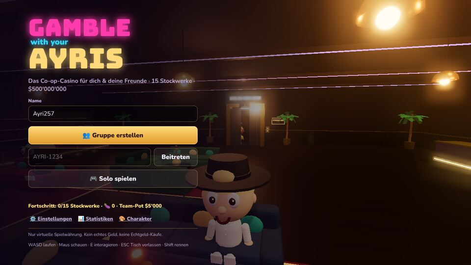
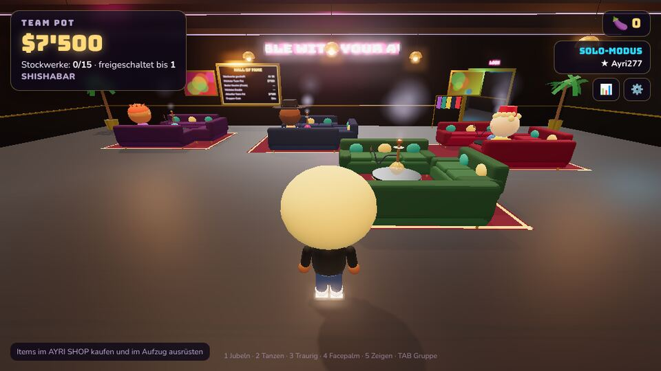
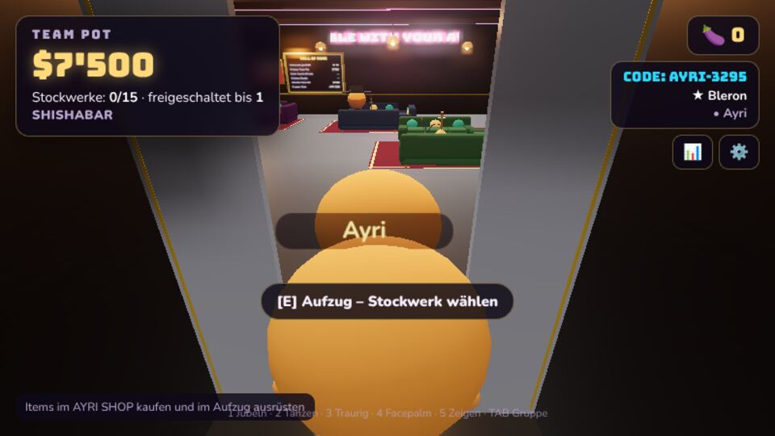
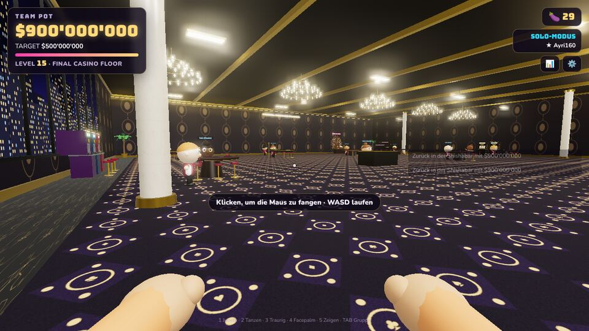
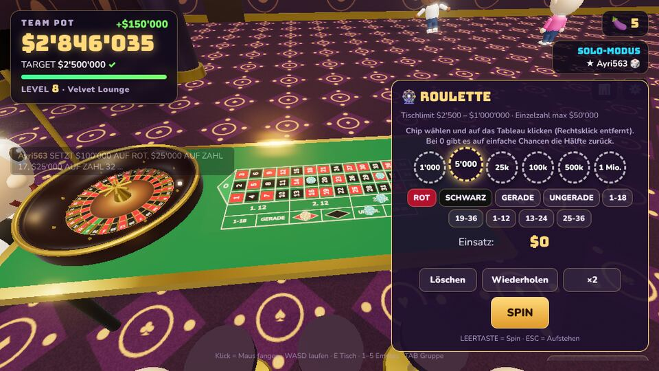
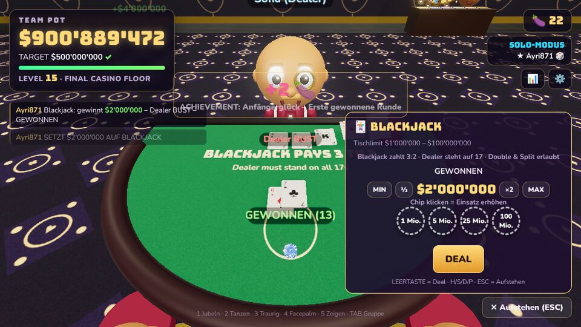
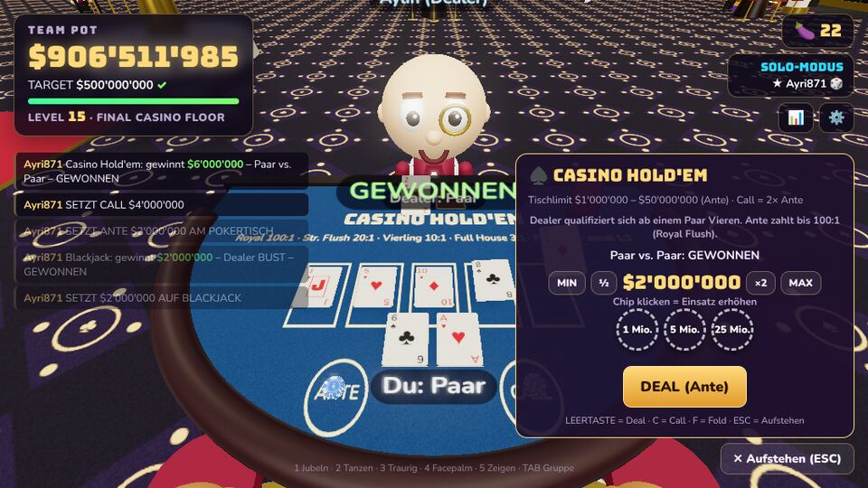
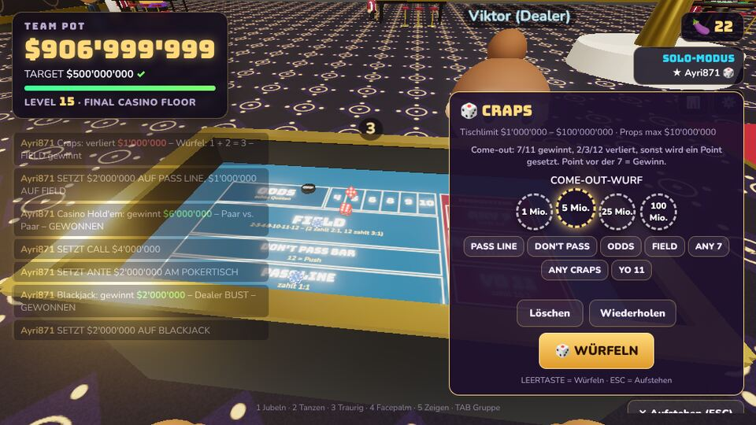
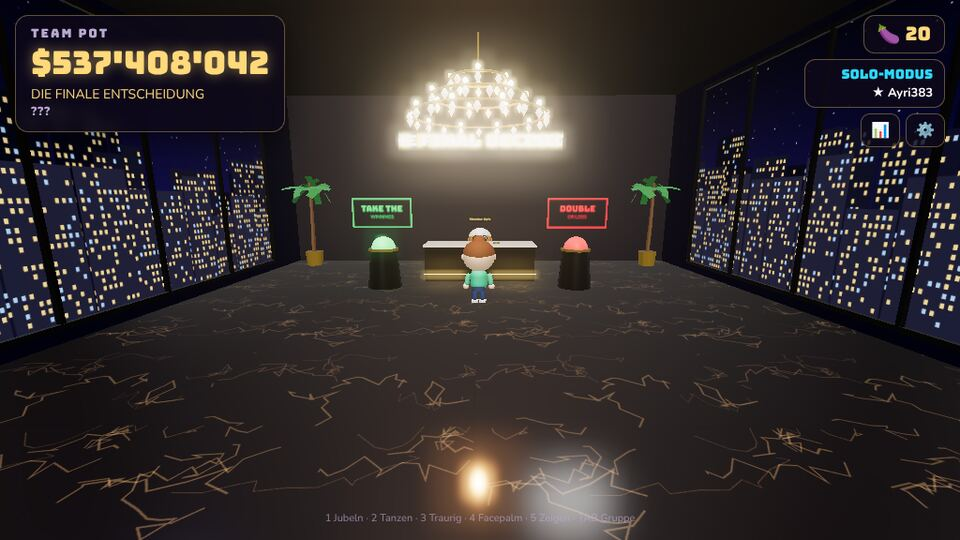
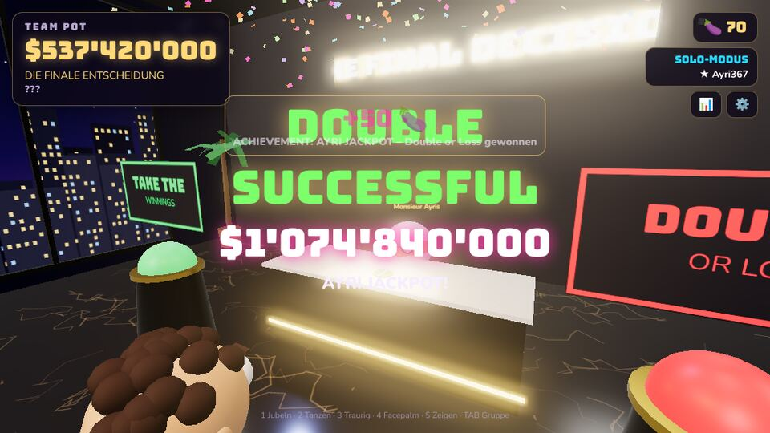

# 🎰 Gamble with your Ayris

Ein humorvolles **3D-First-Person-Co-op-Casino-Spiel** für Freunde – direkt im Browser.
Ihr trefft euch mit euren Cartoon-Charakteren in einer Shishabar, fahrt mit dem Aufzug auf eines von
**15 Casino-Stockwerken**, verzockt gemeinsam einen **Team-Pot** und kämpft euch bis zu
**$500'000'000** hoch – und dann kommt die letzte Frage: **TAKE THE WINNINGS** oder **DOUBLE OR LOSS**?

> ⚠️ Es wird ausschliesslich **virtuelle Spielwährung** verwendet. Kein echtes Geld, keine Echtgeld-Käufe.

| | |
|---|---|
|  |  |
|  |  |
|  |  |
|  |  |
|  |  |

## Schnellstart

```bash
npm install
npm run build
npm start
```

Dann **http://localhost:8787** öffnen.

- **Gruppe erstellen** → es erscheint ein Join-Code wie `AYRI-4827`.
- Freunde öffnen dieselbe Adresse (z. B. `http://<deine-IP>:8787` im selben Netzwerk oder dein
  gehosteter Server) und geben den Code bei **Beitreten** ein.
- **Solo spielen** funktioniert auch ohne Server (der komplette Spielraum läuft dann im Browser).

Entwicklung mit Hot-Reload: `npm run dev` (Vite auf Port 5173, WebSocket wird an den Server auf 8787 weitergeleitet).
Port ändern: `PORT=3000 npm start`.

## Online-Multiplayer mit Render (kostenlos)

Die Datei [`render.yaml`](render.yaml) richtet den Multiplayer-Server auf [Render](https://render.com) ein
(Free-Plan, Node 22, Build `npm ci && npm run build`, Start `npm start`, Health-Check `/health`).

1. Bei Render mit dem GitHub-Konto anmelden → **New → Blueprint** → dieses Repository wählen → **Apply**.
2. Nach dem ersten Build läuft das Spiel samt Multiplayer unter `https://gamble-with-your-ayris.onrender.com`.
3. Die GitHub-Pages-Seite verbindet sich automatisch mit diesem Server. Heisst der Dienst bei Render anders,
   den Namen in [`src/client/server.js`](src/client/server.js) (`RENDER_HOST`) anpassen.

Der Gratis-Server schläft nach 15 Minuten ohne Besucher; das Spiel weckt ihn beim Erstellen/Beitreten automatisch
(dauert bis zu etwa einer Minute). Offene Gruppen gehen dabei verloren, gespeicherte Fortschritte nicht (die liegen im Browser).

## Steuerung

| Taste | Aktion |
|---|---|
| WASD / Pfeile | Laufen (Shift = rennen) |
| Maus | Umschauen (im Casino Klick → Maus fangen; in der Shishabar rechte Maustaste/Drag) |
| E | Interagieren (Aufzug, Tische, Shop, Spiegel, Hall of Fame, Barkeeper); vor einem Spielautomaten: SPIN |
| Leertaste | Springen; am Tisch: Spin / Deal / Würfeln |
| Klick auf Automatenknöpfe | BET − / BET + / SPIN direkt am 3D-Automaten (Fadenkreuz oder Mauszeiger) |
| R / F | Vor einem Spielautomaten: BET + / BET − |
| C | Roulette-Kugelkamera an/aus, solange eine Kugel rollt (nur für dich) |
| Z / Backspace | Roulette: letzten Chip zurücknehmen |
| H / S / D / P / J | Blackjack: Hit / Stand / Double / Split / Joker |
| C / F | Hold'em: Call / Fold (am Pokertisch) |
| ESC / Q | Vom Tisch aufstehen |
| T | MAKKA trinken (nach dem Kauf an der Bar) |
| 1–5 | Emotes (Jubeln, Tanzen, Traurig, Facepalm, Zeigen) |
| TAB | Gruppenübersicht |
| Mausrad | Kamera-Zoom (Shishabar) |

## Spielablauf

- **Shishabar-Lobby** (Third-Person): begehbar, mit Bar, Lounge, Shishas (mit räumlichem Blubbern – je näher, desto lauter), Spiegel/Charaktereditor,
  AYRI SHOP, Hall of Fame und dem grossen Aufzug. Nach jedem Stockwerk – auch nach einem verlorenen –
  kehrt die Gruppe hierher zurück.
- **Aufzug = Levelauswahl**: genau 15 Stockwerke; gesperrte sind sichtbar, freigeschaltete können jederzeit
  erneut besucht werden. Vor der Fahrt wählt jeder bis zu 4 Items aus seinem Inventar.
- **Casino** (First-Person mit sichtbaren Händen): echte 3D-Tische mit NPC-Dealern. Spielbar sind
  Slots, Roulette, Blackjack, Baccarat, Craps, Casino Hold'em, das Glücksrad und High-Limit-Slots.
  Andere Spieler sehen jede Wette (`BLERON SETZT $10'000 AUF ROT`) und können am Tisch zuschauen.
- **Roulette**: Chipwert wählen (`SELECTED CHIP`, Werte passend zum Stockwerk), Chips direkt aufs 3D-Tableau legen –
  Zahlen, Rot/Schwarz, Gerade/Ungerade, 1–18/19–36, Dutzende, Spalten sowie Split, Street, Corner und Six Line auf den
  Linien und Ecken. `TOTAL BET` steht im Panel und auf einer Anzeige am Tisch. Die Chips bleiben nach jedem Spin liegen:
  einfach erneut SPIN (Knopf am Tisch, Panel oder Leertaste) und dieselbe Kombination läuft nochmal. Abgebucht wird erst
  beim Start des Spins; `CLEAR BET`, `UNDO LAST CHIP`, ×2 und Rechtsklick (Chip wegnehmen) bearbeiten die Wette zwischen
  den Spins. Mit **C** folgt eine Kugelkamera der Kugel bis ins Fach, hält kurz auf dem Ergebnis (`17 BLACK – BIG WIN +$72'000`)
  und kehrt dann zurück. Alle sehen Chips, Total Bet, Rad, Kugel und Ergebnis synchron; die Kamera ist pro Spieler.
- **Spielautomaten** werden direkt am Gerät bedient: BET-Anzeige (z. B. `BET $500`), BET −/BET + schalten durch
  die Einsatzstufen des Stockwerks, der grosse SPIN-Knopf bucht den Einsatz sofort aus dem Team-Pot ab und startet
  die Walzen nacheinander. Jeder Automat hat seinen eigenen Einsatz, mehrere Automaten (auch von verschiedenen
  Spielern) drehen gleichzeitig. Während ein Automat dreht oder kurz danach, kann niemand anderes daran den Einsatz
  verstellen. Gewinne gibt es in Stufen – WIN, NICE WIN, BIG WIN, MEGA WIN und JACKPOT – mit eigenen Sounds,
  Münzregen, Lichtern und grosser Anzeige (z. B. `BIG WIN +$75'000`).
- **Team-Pot**: Es gibt nur einen gemeinsamen Geldtopf für den ganzen Run. Der Server prüft und bucht
  jeden Einsatz atomar ab – zwei Spieler können denselben Betrag nie gleichzeitig setzen.
- **Target**: Wird das Ziel erreicht, ist das Level dauerhaft geschafft, das nächste Stockwerk wird
  freigeschaltet – und ihr entscheidet: **RETURN TO SHISHA BAR** oder **KEEP GAMBLING**. Ihr nehmt
  immer genau den Betrag mit, den ihr beim Verlassen besitzt.
- **Mafia**: Fällt der Pot unter den Mindesteinsatz des Stockwerks, stoppt die Musik, das Licht wird rot,
  die Steuerung wird gesperrt und eine eigene Kinokamera zeigt das ganze Team auf einer freien Bühne vor dem Aufzug.
  Die Mafia kommt aus dem Aufzug, Tische, Automaten oder Deko, die im Bild stören würden, werden ausgeblendet –
  cartoonhafte Explosion – **LEVEL FAILED**. Ihr behaltet 75 % des Stockwerk-Startkapitals
  (mind. $7'500), damit der Run weitergehen kann.
- **Dildos 🍆**: Belohnungswährung für den ersten Abschluss jedes Stockwerks, Bonus-Challenges
  (Stockwerk mit ≥150 % des Ziels verlassen) und Achievements – jeweils nur einmal pro Spieler, also kein Farming.
- **MAKKA an der Bar**: Bei Kemal gibt es die pinke Ayri-Limonade für genau 1 🍆. Mit T trinken –
  danach dreht und schwankt die Shishabar 10 Sekunden lang (nur für dich; Mitspieler sehen dich torkeln).
- **AYRI SHOP**: Pokal, Glücks-Shisha, Lucky Hat, Golden Coin, Ayri-Versicherung, Joker Card,
  Mafia Briefcase, Devil Dice, Ayris Crown – jeweils als „einmal verwendbar“ oder „permanent, 1× pro Level“ gekennzeichnet.
- **Finale**: Nach $500'000'000 auf Stock 15 erscheint im Aufzug **???**. In der luxuriösen
  Nacht-Shishabar lauft ihr gemeinsam zum Mitarbeiter: **TAKE THE WINNINGS** speichert den Run,
  **DOUBLE OR LOSS** braucht die Zustimmung aller – dann wirft der Mitarbeiter die grün/rote Münze physisch in der 3D-Szene.

## Speicherstand

Charakter, Kosmetik, Dildos, Items, freigeschaltete/abgeschlossene Stockwerke, Rekorde, Statistiken,
Achievements und Einstellungen werden im Browser (`localStorage`) gespeichert. Der Gruppenersteller bringt
seinen Run (Team-Pot) mit; der Level-Fortschritt wird für alle Mitglieder übernommen.

## Balancing

Alle Werte stehen in [`src/shared/config.js`](src/shared/config.js): Startkapital, Mafia-Anteil,
Zielbeträge, Min/Max-Einsätze pro Spiel als Anteil des Stockwerk-Ziels, Belohnungen und Item-Preise.
Das Spiel ist bewusst als Party-Casino balanciert: Alle Spiele zahlen leicht über 100 % aus, Verlieren bleibt aber
jederzeit möglich. Slots zahlen in Vielfachen des Gesamteinsatzes (ein Treffer bringt mindestens das Doppelte zurück,
dazu AYRI-Multiplikatoren bis ×38 und ein Kronen-Jackpot, der mit jedem Stockwerk wächst); die Tischlimits steigen
mit dem Stockwerk, damit die 15 Ziele bis $500'000'000 realistisch erreichbar sind. Das **Ayri-Glück** würfelt einen verlorenen Ausgang gelegentlich neu – nach mehreren Niederlagen
in Folge häufiger –, damit lange Pechsträhnen selten werden (`luckChance` in `config.js`).
`npm run rtp` zeigt Quoten und Tischlimits, `node scripts/balance.js` simuliert alle Spiele (Auszahlung, Gewinnquote, längste Pechsträhne).

## Architektur

```
server/index.js        Node-Server: statische Auslieferung + WebSocket-Gruppen mit Join-Codes
src/shared/            Autoritative Spiellogik (läuft auf dem Server ODER im Browser für Solo)
  room.js              Raum: Team-Pot, Abstimmungen, Stockwerke, Mafia, Items, Finale
  games/*.js           Slots, Roulette, Blackjack, Baccarat, Craps, Hold'em, Glücksrad
  config.js            Stockwerke, Limits, Items, Achievements
src/client/            Three.js-Client
  world/               Shishabar, Casino-Stockwerke, finale Shishabar, Requisiten
  tables/              3D-Tische mit Animationen und Einsatz-Panels
  character.js         Cartoon-Charaktere + First-Person-Hände
  audio.js             Prozedurale Musik & Sounds (WebAudio) + Dealer-Stimme (Web Speech API)
  ui/                  HUD, Menüs, Aufzug, Shop, Editor, Statistiken
tests/                 node:test – Team-Pot-Sperre, Ziele, Mafia, Items, Finale, Kartenlogik
```

```bash
npm test     # Spiellogik-Tests
```
